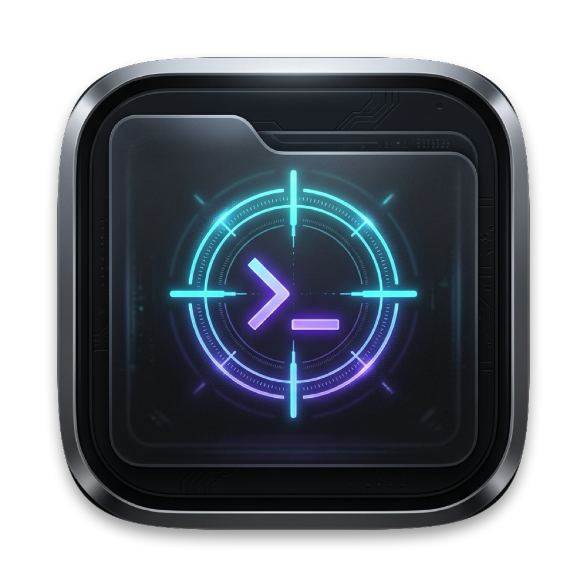

<div align="center">



# Right Here

**Act on the folder you are looking at. Right here.**<br>
The open-source action layer for macOS: send folders and selections to terminals, editors, and AI agents.

[](LICENSE)
[](.)
[](.)
[-6B57D2?style=flat-square)](.)
[](.)

[Website](https://boyugou.github.io/right-here/) · [Install](#install) · [CLI Usage](#use) · [Connect AI Assistant](#connect-an-ai-assistant) · [Architecture](#how-it-works) · [Documentation](docs/INDEX.md)

<br>

<table>
  <tr>
    <td align="center" width="33%"><b>Finder Menu & Workspace App</b></td>
    <td align="center" width="33%"><b>AI Agents & Isolated Worktrees</b></td>
    <td align="center" width="33%"><b>Unified CLI & Automation</b></td>
  </tr>
  <tr>
    <td align="left"><sub>Open any folder or selection in your terminal or editor: Ghostty, Terminal, iTerm2, WezTerm, kitty, VS Code, Cursor, Zed and more. A setup app with a live preview of the Finder menu and diagnostics.</sub></td>
    <td align="left"><sub>Start Claude Code, Codex, Antigravity (<code>agy</code>) or any command-line agent in your own login shell. Run one in an isolated git worktree (<code>--worktree</code>) to keep it away from your working copy.</sub></td>
    <td align="left"><sub>No daemon of its own. Every menu action is an <code>rh run</code> command you can dry-run, with JSON output and an MCP server for AI assistants.</sub></td>
  </tr>
</table>

</div>

---

Right Here is a macOS action layer: a sandboxed Finder Sync extension, a command-line tool (`rh`), a plain-text configuration file (`~/.config/right-here/config.toml`) and a Model Context Protocol (MCP) server.

Developers use contextual right-clicks in Finder or the native macOS workspace app; AI assistants use the exact same actions from the terminal or over MCP.

- **No daemon of its own.** The Finder extension lives in the extension process Finder starts and keeps loaded (so the menu is there when you right-click); `rh` runs only when something calls it.
- **Isolated git worktrees.** AI coding agents can execute inside dedicated, temporary git worktrees (`--worktree`), ensuring your active git branch and uncommitted modifications remain untouched.
- **Safe by construction.** File names travel as argv entries and AppleScript arguments, never inside a shell string or AppleScript source; a terminal is only ever handed a folder. The extension is sandboxed and has no network entitlement.
- **One set of actions.** Anything in the Finder menu can be previewed, tested and run with `rh run <action>` or over MCP.
- **Local-first configuration.** Configured via standard TOML with JSON Schema validation (`rh config schema`) and optional multi-device sync without third-party servers.
- **Native.** Apple silicon, macOS 26 or later, Dark Mode, and 30 languages including right-to-left ones (machine-translated, awaiting native-speaker review).

## How it works

```
┌──────────────┐   MCP (stdio)   ┌───────────────┐        ┌──────────────────┐
│ AI assistant │ ◄─────────────► │    rh mcp     │ ◄────► │  RightHereCore   │
│(Claude, agy) │    typed tools  │ (MCP server)  │        │  Config & Models │
└──────────────┘                 └───────────────┘        └────────┬─────────┘
                                                                   │
┌──────────────┐   right-click   ┌───────────────┐                 │
│ Finder / You │ ◄─────────────► │ FinderSync    │ ◄───────────────┤
└──────────────┘                 │ (Extension)   │                 │
                                 └───────┬───────┘                 │
                                         │ runner script           ▼
                                         ▼                ┌──────────────────┐
                                 ┌───────────────┐        │  macOS Apps      │
                                 │ rh runner     │ ◄────► │  Terminals & IDEs│
                                 │ (~/.local/bin)│        └────────┬─────────┘
                                 └───────┬───────┘                 │
                                         │ --worktree              │
                                         ▼                         ▼
                                ┌─────────────────┐       ┌──────────────────┐
                                │ .right-here/    │       │ Isolated Worktree│
                                │ worktrees/      │       │ (Clean Git State)│
                                └─────────────────┘       └──────────────────┘
```

When you right-click in Finder or run an action:
1. The **FinderSync Extension** resolves the container folder or selection.
2. It generates menu nodes in accordance with your `config.toml`.
3. Choosing an action hands it to `rh` through a runner script outside the extension's sandbox; `rh` resolves the configured terminal or editor and starts it.
4. When `--worktree` is specified, Right Here branches a clean git worktree under `.right-here/worktrees/`, automatically adds `.right-here` to `.git/info/exclude`, and launches the agent in that isolated environment.

## What you get

Right-click a folder, a file, or the empty canvas of a Finder window:

- **Open in a terminal or editor**: Ghostty and Terminal are verified on a real Mac; iTerm2, WezTerm and kitty are built in but not yet verified (`rh doctor --probe-launch` checks yours); VS Code, Cursor, Zed, Antigravity and other editors.
- **Start an AI agent here**: Claude Code, Codex, Antigravity (`agy`) and others, typed into your chosen terminal. The command is typed into your own interactive login shell, preserving your environment, `PATH`, `nvm`, and aliases.
- **Isolated Git Worktrees**: Run agents in dedicated worktree branches (`rh run agent.agy --worktree`), protecting your active working tree from partial AI edits.
- **Folder Bookmarks & Pins**: Pin frequently accessed project directories (`rh pin <folder>`), list them (`rh pins`), and inspect recent project directories (`rh recents`).
- **New file from templates**: Instantly create empty text or Markdown files (or custom project templates), automatically revealing or opening them.
- **Copy Path in any format**: Absolute, `~`-relative, git-repository-relative, bare filename, shell-escaped, or formatted as `@path` mentions ready for AI prompts.

Every action is accessible via the CLI:
```sh
rh run agent.claude
rh run agent.agy --worktree
rh run copy-path.git-relative src/main.swift
rh run new-file.md --container ~/notes
```
Add `--dry-run --json` to inspect the exact planned execution before running.

## Install

### Build from source

A notarized DMG is built with `script/package_dmg.sh` (see `docs/development/RELEASING.md`); downloads will be published with the first public release.

Requires Xcode 26 or later and `xcodegen`:

```sh
brew install xcodegen
./script/install_local.sh     # build, copy to ~/Applications, link rh into ~/.local/bin, enable extension
rh doctor                     # verify all diagnostics pass
```

If `rh doctor` indicates the extension needs activation, toggle Right Here under **System Settings › General › Login Items & Extensions › Finder**.

## Use

```sh
rh init                       # create ~/.config/right-here/config.toml
rh menu                       # preview the Finder menu (--explain shows filtered items)
rh actions                    # list all actions available in the current directory
rh run agent.claude           # launch Claude Code in current directory
rh run agent.agy --worktree   # launch Antigravity in an isolated git worktree
rh worktree list              # list active git worktrees
rh pins                       # list pinned directories
rh doctor                     # run full diagnostic health check
rh doctor --probe-launch      # test terminal AppleEvent automation launch
```

Shell completions:
```sh
rh --generate-completion-script zsh > ~/.zfunc/_rh
```

## Configure

Configuration is stored in `~/.config/right-here/config.toml`, validated strictly against a schema:

```toml
[general]
terminal = "ghostty"
terminal_placement = "tab"                     # open in tab instead of new window
editor = "vscode"
agents = ["claude", "agy", "codex", "lazygit"] # enabled agents in menu order

[menu]
items = ["open-terminal", "open-editor", "agents", "-", "new-file", "copy-path"]

[new_file]
then = "open"

[[new_file.template]]
id = "md"
title = "Markdown Document"
extension = "md"
open_with = "typora"

[agent.claude]
command = "claude --model opus"

[agent.agy]
name = "Antigravity"
command = "agy"

[agent.lazygit]
name = "lazygit"
command = "lazygit"
```

- Validate configuration: `rh config validate` (supports `--strict`).
- Inspect configuration files: `rh config show`.
- Export schema: `rh config schema`.
- Sync across machines: `rh config sync enable` (uses private folder or iCloud Drive; commands are protected by `--allow-commands`).

## Connect an AI Assistant

### Claude Code Plugin

Install the official Right Here plugin in Claude Code for contextual workspace actions and Finder automation ([`plugins/right-here`](plugins/right-here/README.md)):

```sh
/plugin marketplace add boyugou/right-here
/plugin install right-here@right-here
```

### Model Context Protocol (MCP)

To connect Claude Desktop, Cursor, Zed, Windsurf, or Antigravity, add `rh mcp` as a stdio server:

```json
{
  "mcpServers": {
    "right-here": {
      "command": "rh",
      "args": ["mcp"]
    }
  }
}
```

The server provides typed tools:
- `right_here_actions`, `right_here_menu`, `right_here_catalog`: what can be done here, the menu, the terminals, editors and agents.
- `right_here_run`: run an action (`agent.*`, `copy-path.*`, `new-file.*`); use `dry_run` first.
- `right_here_finder_selection`: the current Finder selection or window folder.
- `right_here_doctor`, `right_here_config_validate`, `right_here_docs`: diagnostics and the built-in guides.
- `right_here_bookmarks`: pinned and recent folders.
- `right_here_worktree`: list, create or remove the isolated git worktrees Right Here made (never forced, never one you made yourself).

### Automated Setup via AI

Right Here provides an automated onboarding guide for AI assistants:
- Run `rh docs agent-setup` for the full agent playbook.
- In **Right Here.app**, click **Copy Setup Prompt for AI** to have your assistant verify dependencies and configure your system.

## Safety & App Store Readiness

- **Data isolation**: File paths are strictly processed as argv arguments and AppleScript descriptors, preventing shell injection vulnerabilities.
- **Type verification**: Terminal actions verify that target directories are valid containers before launching.
- **No telemetry**: no analytics, no network connections of its own, nothing leaves your Mac. The sandboxed extension has no network entitlement.
- **Mac App Store**: a sandboxed, menu-only edition is drafted (scope and open questions in the design notes); it is not submitted.
- See [`docs/DESIGN.md`](docs/DESIGN.md) and [`docs/appstore/METADATA.md`](docs/appstore/METADATA.md).

## Languages

Right Here ships in 30 languages, right-to-left ones included: Arabic, Bengali, German, Greek, English, Spanish, Persian, French, Hebrew, Hindi, Indonesian, Italian, Japanese, Korean, Marathi, Malay, Dutch, Polish, Portuguese (Brazil), Romanian, Russian, Tamil, Telugu, Thai, Turkish, Ukrainian, Urdu, Vietnamese, Simplified Chinese and Traditional Chinese. The translations are machine-made and not yet reviewed by native speakers.

The command-line interface stays in English for predictable scripting.

## License

Apache-2.0. See [`LICENSE`](LICENSE) for details.
