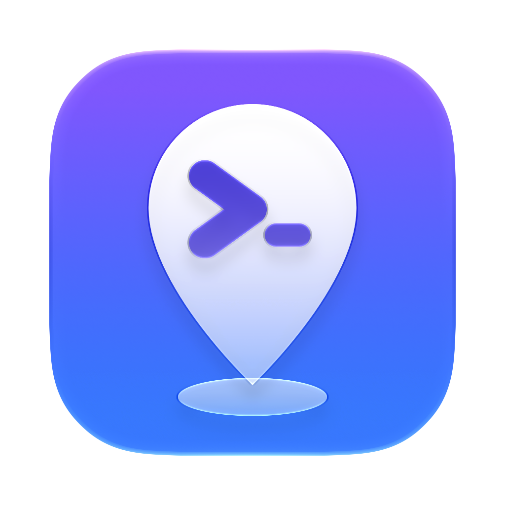
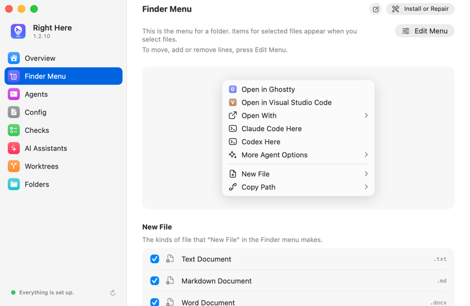
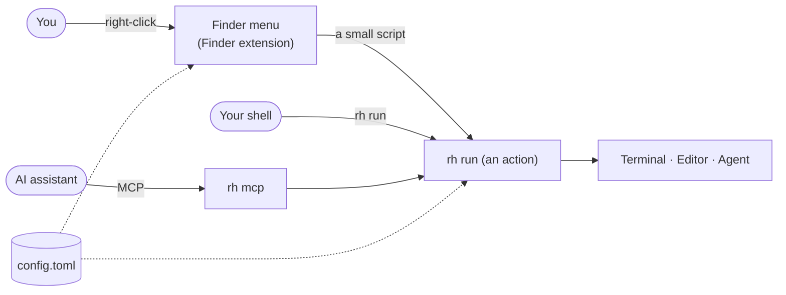

<div align="center">



# Right Here

**Right-click a folder. Open it in your terminal, your editor or an AI agent.**

[](https://github.com/boyugou/right-here/actions/workflows/ci.yml)
[](LICENSE)
[](Package.swift)
[](#install)
[](#use-with-ai-assistants)
[](#languages)

[Website](https://boyugou.github.io/right-here/) · [Install](#install) · [Set up](#set-up) · [Command line](#use-the-command-line) · [AI assistants](#use-with-ai-assistants) · [Documentation](docs/INDEX.md) · [Changelog](CHANGELOG.md)

<br>

<picture>
  <source media="(prefers-reduced-motion: reduce)" srcset="docs/images/demo-static.svg">
  
</picture>

</div>

## What Right Here does

Right Here adds a menu to Finder. Right-click a folder, a file or the empty part of a window. Then choose an action:

| Action | What it does |
| --- | --- |
| **Open in a terminal** | Opens the folder in Ghostty, Terminal, iTerm2, WezTerm, kitty, Alacritty, Warp, cmux, or a terminal that you add. Agents start in all of them but Warp and cmux. |
| **Open in an editor** | Opens the folder or the files in VS Code, Cursor, Zed, Xcode or another editor. |
| **Start an AI agent** | Starts Claude Code, Codex, Gemini CLI or another agent in the folder. Your login shell runs it, with your `PATH` and aliases. |
| **Agent presets** | Starts an agent with a prompt that names the selected files: Review, Explain, a test plan, or your own. |
| **New File** | Makes a text file, a Markdown file, a blank Word, Excel or PowerPoint document, or a file from your own template. |
| **Copy Path** | Copies the path in the form that you need: full, from your home, from the git root, or as an `@` mention for an agent. |
| **Reveal in Finder** | Selects the items in a Finder window. Not in the menu at first. |
| **Repository link** | Copies or opens the page of the file on GitHub, GitLab, Codeberg or Bitbucket, at the commit that you have checked out. Not in the menu at first: see below. |

To change the menu:

1. Open Right Here and go to the **Finder Menu** page.
2. Press **Edit Menu**.
3. Drag a line to move it. Uncheck a line to take it out.
4. Under **Not in the Menu**, check an item to put it in: Reveal in Finder, Copy Repository Link, Open Repository Page or a group.

From a terminal: `rh config add menu.items repository.copy-link`.

<picture>
  <source media="(prefers-color-scheme: dark)" srcset="docs/images/setup-dark.png">
  
</picture>

The same actions also run from:

- the `rh` command;
- Quick Actions (right-click, then **Quick Actions**). They are also Services, so you can give one a keyboard shortcut for the items
  selected in Finder: System Settings › Keyboard › Keyboard Shortcuts › Services;
- the Shortcuts app, Siri and Spotlight, where a shortcut can also pick one of your pinned or recent folders;
- AI assistants.

## How it works



- The Finder extension reads your config file and builds the menu. It is sandboxed and has no network access.
- A click runs `rh` through a small script that the Finder extension is allowed to start (`rh setup` writes it to
  `~/Library/Application Scripts/com.boyugou.righthere.FinderExtension/`). The script runs as you, outside the sandbox. `rh` opens the
  app, or types the agent's command into your terminal.
- Apart from the Finder extension, which macOS keeps loaded while Finder runs, Right Here runs nothing in the background. `rh` runs only
  when something calls it.

## Install

You need a Mac with Apple silicon and macOS 26 or later.

1. Download the DMG of the [latest release](https://github.com/boyugou/right-here/releases/latest). It is signed and notarized by Apple.
2. Open the DMG and drag **Right Here** to **Applications**.
3. Open Right Here from **Applications**.

Or install it with Homebrew, from the project's own tap:

```sh
brew install --cask boyugou/tap/right-here
```

To build from source, you need Xcode 26 or later and `xcodegen`:

```sh
brew install xcodegen
./script/install_local.sh     # builds the app, copies it to ~/Applications and runs `rh setup`
```

## Set up

1. Open Right Here. Choose your terminal, your editor and your agents. Press **Set Up**.
2. Turn on the Finder extension in System Settings › General › Login Items & Extensions › Finder. The setup window has a button that opens
   this page.
3. Right-click a folder in Finder. The first time an agent starts in your terminal, macOS asks whether Right Here may control it: choose
   **Allow**.

You can also run setup in a terminal. Before setup, the command is inside the app: `"/Applications/Right Here.app/Contents/Helpers/rh" setup`.
Setup links it as `~/.local/bin/rh` and says the line to add to your shell's startup file when that folder is not on your `PATH`. Or let an
AI assistant do it: press **Copy Setup Prompt for AI** in the app, and paste the prompt.

**To update,** download the new DMG and drag the app over the old one. Choose **Replace**. With Homebrew, run `brew upgrade --cask right-here`
instead. Then open Right Here and press **Install or Repair**. Your config file stays as it is.

**If the menu is missing,** run `rh doctor`: it checks each part and says what to fix. In a folder in iCloud Drive (Desktop and
Documents too, when they are in iCloud), Finder shows no menus of extensions: use right-click › **Quick Actions** there.
`rh docs troubleshooting` has the rest.

**To uninstall,** run `rh uninstall`, which takes out what setup made and keeps your config file, then move the app to the Trash. With
Homebrew, run `brew uninstall --cask right-here` after `rh uninstall`.

## Use the command line

| Command | What it does |
| --- | --- |
| `rh setup` | Sets up everything. `--dry-run` shows what it would do. |
| `rh menu` | Shows the Finder menu for the current folder. `--explain` says why an item is missing. |
| `rh actions` | Lists the actions that you can run here. |
| `rh run agent.claude` | Starts Claude Code in the current folder. |
| `rh run agent.codex --worktree` | Starts Codex in a new git worktree. Your working copy does not change. |
| `rh run copy-path.git-relative src/main.swift` | Copies the path of a file, from the git root. |
| `rh doctor` | Checks the setup and says what to fix. |
| `rh doctor --probe-launch` | Proves that a click can start an agent. A terminal window opens and closes. |

Add `--dry-run --json` to `rh run` to see what an action would do, without doing it.

## Configure

Right Here keeps its settings in one text file, `~/.config/right-here/config.toml`:

```toml
[general]
terminal = "ghostty"
editor = "vscode"
agents = ["claude", "codex"]

[agent.claude]
command = "claude --model opus"
```

- **In the setup window**, every page changes the config file. The window saves each change at once, and **Undo** takes it back.
- **With `rh config`**, change one setting at a time. For example: `rh config set general.terminal ghostty`, `rh config add menu.items open.app.zed --at 3`, `rh config undo`. Your comments stay in the file.
- `rh config validate` checks the file. `rh docs config` lists every setting.
- `config.local.toml` holds the settings of this Mac only. `rh config sync` copies `config.toml` to your other Macs, through a folder
  that you choose: iCloud Drive, Dropbox or a git checkout.

## Use with AI assistants

**Claude Code.** Install the plugin ([`plugins/right-here`](plugins/right-here/README.md)):

```sh
/plugin marketplace add boyugou/right-here
/plugin install right-here@right-here
```

**Other apps (MCP).** MCP, the Model Context Protocol, is the way AI apps use tools. Add `rh mcp` as a server that the app starts and
talks to over standard input and output (a "stdio" server). Use the full path of `rh`, because apps that start from the Dock do not find it on their `PATH`. The **AI Assistants** page of the app has **Copy MCP Configuration**, which writes the right path for this Mac:

```json
{
  "mcpServers": {
    "right-here": { "command": "/Users/you/.local/bin/rh", "args": ["mcp"] }
  }
}
```

| Tool | What it does |
| --- | --- |
| `right_here_actions`, `right_here_menu`, `right_here_catalog` | List the actions, the Finder menu, and the terminals, editors and agents. |
| `right_here_run` | Runs an action. Use `dry_run` first. |
| `right_here_finder_selection` | Reads what is selected in Finder. |
| `right_here_config_get`, `right_here_config_edit`, `right_here_config_validate` | Read, change and check the config. |
| `right_here_doctor`, `right_here_docs` | Check the setup, and read the guides. |
| `right_here_bookmarks`, `right_here_worktree` | List pinned and recent folders, and manage the git worktrees that Right Here made. |

Through these tools, an AI assistant cannot change by itself which program a click starts, or switch off an agent's permission prompts. It proposes the change. You look at it and apply it on the **Config** page of the app, or with `rh config pending`. An assistant that runs commands in your shell runs `rh` as you do; the setup guide tells it to wait for your yes before such a change.

To let an assistant set Right Here up, give it [`docs/AGENT_SETUP.md`](docs/AGENT_SETUP.md) (also `rh docs agent-setup`).

## Safety

- **File names are data.** Right Here passes paths to apps as arguments, never as shell text. Where a name must be typed into a shell, one tested function writes it so that zsh, bash, fish, tcsh, nushell and PowerShell all read it as it is.
- **A terminal only gets folders.** A terminal runs a file that it gets, so Right Here never gives it one.
- **Agents keep their permission prompts** unless you switch them off, and a preset keeps them even then. An alias of your shell that adds
  an agent's flag to skip them switches them off for every start; `rh doctor` names such an alias.
- **You approve what starts.** Through the MCP tools, an AI assistant proposes a change of what a click starts; it does not make it. A config from a sync folder that would start something new is pulled only with your yes to the list it shows.
- **Your own Quick Actions stay yours.** Right Here never replaces or removes a Quick Action it did not write.
- **No telemetry.** Right Here makes no network connections of its own.

[`docs/DESIGN.md`](docs/DESIGN.md) (section 9) has the full list. [`SECURITY.md`](SECURITY.md) says how to report a problem.

## Status

Right Here has been public since 1.0 (2026-10-29). Config keys and the command line's output can still change from one version to the next, and the [CHANGELOG](CHANGELOG.md) says what changed. Tests cover the planning code, the command line, the Quick Actions, the MCP server and the plugin. They use temporary folders and real shells. Some parts need a real Finder and real terminals, and [`docs/development/MANUAL_CHECKS.md`](docs/development/MANUAL_CHECKS.md) lists them. Ghostty and Terminal were tried on a real Mac. Not tried on a real Mac yet: the other terminals, a preset in a real terminal, the
actions in Shortcuts and Spotlight, and config sync through real iCloud Drive.

## Languages

The app and the Finder menu are in 30 languages, including Arabic, Hebrew, Persian and Urdu. They follow the language of your Mac, or the one
you choose on the Overview page of the app. The translations are machine-made, and a second model has read each language against the English; no native speaker has yet, and corrections are welcome. The `rh` command stays in English, for scripts.

## License

Apache-2.0. See [`LICENSE`](LICENSE).
