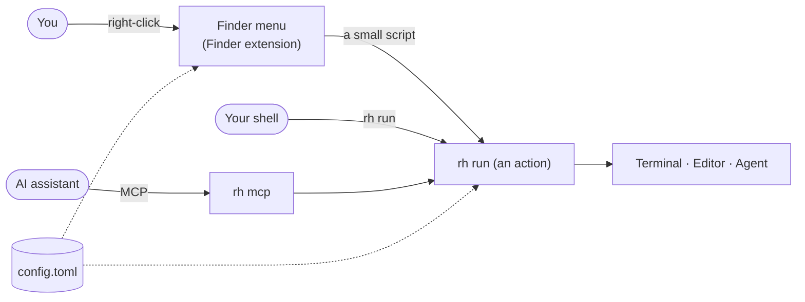
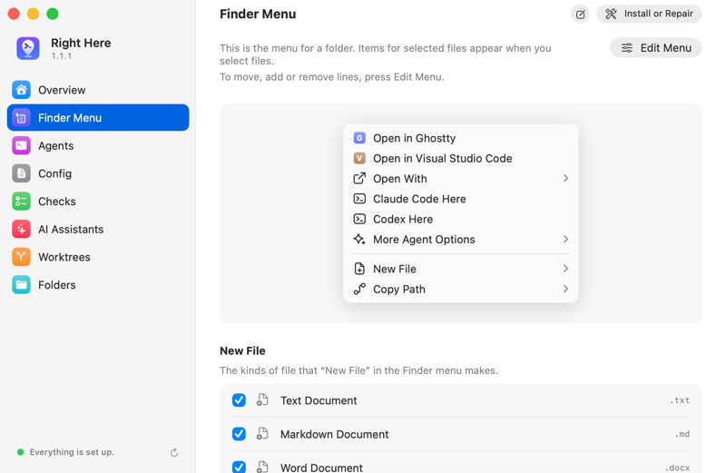

<div align="center">


# Right Here

**Right-click a folder. Open it in your terminal, your editor or an AI agent.**

[](LICENSE)
[](Package.swift)
[](#install)
[](#use-with-ai-assistants)
[](#languages)

[Website](https://boyugou.github.io/right-here/) · [Install](#install) · [Set up](#set-up) · [Command line](#use-the-command-line) · [AI assistants](#use-with-ai-assistants) · [Documentation](docs/INDEX.md) · [Changelog](CHANGELOG.md)

<br>

<picture>
  <source media="(prefers-reduced-motion: reduce)" srcset="docs/images/demo-static.svg">
  
</picture>

</div>

## What Right Here does

Right Here adds a menu to Finder. Right-click a folder, a file or the empty part of a window. Then choose an action:

| Action | What it does |
| --- | --- |
| **Open in a terminal** | Opens the folder in Ghostty, Terminal, iTerm2, WezTerm, kitty, Alacritty, or a terminal that you add. |
| **Open in an editor** | Opens the folder or the files in VS Code, Cursor, Zed, Xcode or another editor. |
| **Start an AI agent** | Starts Claude Code, Codex, Gemini CLI or another agent in the folder. Your login shell runs it, with your `PATH` and aliases. |
| **Agent presets** | Sends the selected files to an agent with a prompt: Review, Explain, Write Tests, or your own. |
| **New File** | Makes a text file, a Markdown file, a blank Word, Excel or PowerPoint document, or a file from your own template. |
| **Copy Path** | Copies the path in the form that you need: full, from your home, from the git root, or as an `@` mention for an agent. |
| **Reveal in Finder** | Selects the items in a Finder window. Not in the menu at first. |
| **Repository link** | Copies or opens the page of the file on GitHub, GitLab, Codeberg or Bitbucket, at the commit that you have checked out. Not in the menu at first: see below. |

To change the menu, open Right Here, go to the **Finder Menu** page and press **Edit Menu**: drag a line to move it, uncheck it to take it out, and under **Not in the Menu** check Reveal in Finder, Copy Repository Link, Open Repository Page or a group to put it in. From a terminal: `rh config add menu.items repository.copy-link`.

The same actions run from the `rh` command, from Quick Actions (right-click, then **Quick Actions**), from the Shortcuts app, Siri and Spotlight (where a shortcut can also pick one of your pinned or recent folders) and from AI assistants.

## How it works



- The Finder extension reads your config file and builds the menu. It is sandboxed and has no network access.
- A click runs `rh` through a small script that the Finder extension is allowed to start. `rh` opens the app, or types the agent's command into your terminal.
- Right Here runs no background process of its own. `rh` runs only when something calls it.

## Install

You need a Mac with Apple silicon and macOS 26 or later.

1. Download the DMG of the [latest release](https://github.com/boyugou/right-here/releases/latest).
2. Open the DMG and drag **Right Here** to **Applications**.
3. Open Right Here from **Applications**.

Or install it with Homebrew, from the project's own tap:

```sh
brew install --cask boyugou/tap/right-here
```

To build from source, you need Xcode 26 or later and `xcodegen`:

```sh
brew install xcodegen
./script/install_local.sh     # builds the app, copies it to ~/Applications and runs `rh setup`
```

## Set up

1. Open Right Here. Choose your terminal, your editor and your agents. Press **Set Up**.
2. Turn on the Finder extension in System Settings › General › Login Items & Extensions › Finder. The setup window opens this page for you.
3. Right-click a folder in Finder.

<picture>
  <source media="(prefers-color-scheme: dark)" srcset="docs/images/setup-dark.png">
  
</picture>

You can also run `rh setup` in a terminal. Or let an AI assistant do it: press **Copy Setup Prompt for AI** in the app, and paste the prompt.

**To update,** download the new DMG and drag the app over the old one. Choose **Replace**. With Homebrew, run `brew upgrade --cask right-here`
instead. Then open Right Here and press **Install or Repair**. Your config file stays as it is.

## Use the command line

| Command | What it does |
| --- | --- |
| `rh setup` | Sets up everything. `--dry-run` shows what it would do. |
| `rh menu` | Shows the Finder menu for the current folder. `--explain` says why an item is missing. |
| `rh actions` | Lists the actions that you can run here. |
| `rh run agent.claude` | Starts Claude Code in the current folder. |
| `rh run agent.codex --worktree` | Starts Codex in a new git worktree. Your working copy does not change. |
| `rh run copy-path.git-relative src/main.swift` | Copies the path of a file, from the git root. |
| `rh doctor` | Checks the setup and says what to fix. |
| `rh doctor --probe-launch` | Proves that a click can start an agent. A terminal window opens and closes. |

Add `--dry-run --json` to `rh run` to see what an action would do, without doing it.

## Configure

Right Here keeps its settings in one text file, `~/.config/right-here/config.toml`:

```toml
[general]
terminal = "ghostty"
editor = "vscode"
agents = ["claude", "codex"]

[agent.claude]
command = "claude --model opus"
```

- **In the setup window**, every page changes the config file. The window saves each change at once, and **Undo** takes it back.
- **With `rh config`**, change one setting at a time. For example: `rh config set general.terminal ghostty`, `rh config add menu.items open.app.zed --at 3`, `rh config undo`. Your comments stay in the file.
- `rh config validate` checks the file. `rh docs config` lists every setting.
- `config.local.toml` holds the settings of this Mac only. `rh config sync` copies `config.toml` to your other Macs.

## Use with AI assistants

**Claude Code.** Install the plugin ([`plugins/right-here`](plugins/right-here/README.md)):

```sh
/plugin marketplace add boyugou/right-here
/plugin install right-here@right-here
```

**Other apps (MCP).** MCP, the Model Context Protocol, is the way AI apps use tools. Add `rh mcp` as a stdio server. Use the full path of `rh`, because apps that start from the Dock do not find it on their `PATH`. The **AI Assistants** page of the app has **Copy MCP Configuration**, which writes the right path for this Mac:

```json
{
  "mcpServers": {
    "right-here": { "command": "/Users/you/.local/bin/rh", "args": ["mcp"] }
  }
}
```

| Tool | What it does |
| --- | --- |
| `right_here_actions`, `right_here_menu`, `right_here_catalog` | List the actions, the Finder menu, and the terminals, editors and agents. |
| `right_here_run` | Runs an action. Use `dry_run` first. |
| `right_here_finder_selection` | Reads what is selected in Finder. |
| `right_here_config_get`, `right_here_config_edit`, `right_here_config_validate` | Read, change and check the config. |
| `right_here_doctor`, `right_here_docs` | Check the setup, and read the guides. |
| `right_here_bookmarks`, `right_here_worktree` | List pinned and recent folders, and manage the git worktrees that Right Here made. |

An AI assistant cannot change by itself which program a click starts, or switch off an agent's permission prompts. It proposes the change. You look at it and apply it on the **Config** page of the app, or with `rh config pending`.

To let an assistant set Right Here up, give it [`docs/AGENT_SETUP.md`](docs/AGENT_SETUP.md) (also `rh docs agent-setup`).

## Safety

- **File names are data.** Right Here passes paths to apps as arguments, never as shell text. Where a folder must be typed into a shell, one tested function quotes it.
- **A terminal only gets folders.** A terminal runs a file that it gets, so Right Here never gives it one.
- **Agents keep their permission prompts** unless you switch them off. A preset always keeps them.
- **No telemetry.** Right Here makes no network connections of its own.

[`docs/DESIGN.md`](docs/DESIGN.md) (section 9) has the full list. [`SECURITY.md`](SECURITY.md) says how to report a problem.

## Status

Right Here has been public since 1.0 (2026-10-29). Config keys and the command line's output can still change from one version to the next, and the [CHANGELOG](CHANGELOG.md) says what changed. Tests cover the planning code, the command line, the Quick Actions, the MCP server and the plugin. They use temporary folders and real shells. Some parts need a real Finder and real terminals, and [`docs/development/MANUAL_CHECKS.md`](docs/development/MANUAL_CHECKS.md) lists them. Ghostty and Terminal were tried on a real Mac. The other terminals were not tried yet.

## Languages

The app and the Finder menu are in 30 languages, including Arabic, Hebrew, Persian and Urdu. They follow the language of your Mac, or the one
you choose on the Overview page of the app. The translations are machine-made and wait for review by native speakers. The `rh` command stays in English, for scripts.

## License

Apache-2.0. See [`LICENSE`](LICENSE).
